# 🚀 AI Agent for Automated Instagram Posting

[](https://n8n.io)
[](https://aistudio.google.com/)
[](https://developers.facebook.com/)
[](https://www.pexels.com/api/)
[](LICENSE)

An autonomous, end-to-end AI agent workflow built with **n8n** that creates and publishes Instagram Reels automatically on a set schedule. Powered by **Google Gemini** for intelligent idea and caption generation, **Pexels** for HD vertical stock footage, and the **Instagram Graph API** for direct reel container creation and publishing.

---

## 📌 Architecture & Workflow Flowchart

```mermaid
flowchart LR
    A[⏰ Schedule Trigger<br/>Daily at 9:00 AM] --> B[🧠 Google Gemini AI<br/>Basic LLM Chain]
    B --> C[⚙️ Code Parser<br/>Extract Topic, Caption, Hashtags & Keyword]
    C --> D[🎥 Pexels API<br/>Search Matching HD Videos]
    D --> E[🎲 Random Video Selector<br/>Pick Dynamic Video URL]
    E --> F[📥 Video Downloader<br/>Buffer Media File]
    F --> G[💾 File Handler<br/>Local Cache]
    G --> H[📤 Instagram Graph API<br/>Create Media Container]
    H --> I[⏳ Wait Node<br/>10s Processing Buffer]
    I --> J[🚀 Instagram Graph API<br/>Publish Media Reel]
```



---

## ✨ Key Features

- **🤖 AI-Powered Content Creation**: Uses Google Gemini via LangChain to generate fresh, non-repetitive Instagram Reel topics, hooky captions, and exactly 10 niche-specific hashtags (focused on Web Design, UI/UX, SEO, Coding, and Digital Agency).
- **🎬 Contextual HD Video Sourcing**: Automatically queries the Pexels Video Search API using AI-determined keywords (`website design`, `ui ux design`, `software developer`, `laptop coding`, etc.) to find vertical, high-quality B-roll.
- **🎲 Dynamic Randomization**: Selects a different video from search results each day to ensure your feed stays vibrant and original.
- **📲 Direct Instagram Publishing**: Automates the two-step Instagram Reels publishing pipeline (`/media` upload container creation followed by `/media_publish`).
- **⏰ Set-and-Forget Automation**: Pre-configured to trigger automatically every morning at 9:00 AM, requiring zero daily manual effort.

---

## 📂 Repository Structure

```
├── AI Agent for Reel Automation.json   # Exported n8n workflow file (Ready to import)
├── .env.example                         # Environment variables template
├── .gitignore                           # Ignored files (media files, secrets)
├── LICENSE                              # MIT License
└── README.md                            # Documentation & Setup Guide
```

---

## 🛠️ Prerequisites

Before importing and running the workflow, make sure you have:

1. **[n8n](https://n8n.io/)**: Self-hosted (Docker / npm / Cloud) or an n8n Cloud instance.
2. **Google Gemini API Key**:
   - Get a free or pay-as-you-go key from [Google AI Studio](https://aistudio.google.com/).
3. **Pexels API Key**:
   - Create a free developer account at [Pexels Developer Portal](https://www.pexels.com/api/) to get your API key.
4. **Instagram Professional / Creator Account**:
   - An Instagram Professional/Business account connected to a Facebook Page.
   - A Meta Developer App with the **Instagram Graph API** permission (`instagram_basic`, `instagram_content_publish`).
   - A Long-Lived User or Page Access Token and your Instagram Business Account ID.

---

## 🚀 Setup & Installation Guide

### Step 1: Clone or Download the Repository

```bash
git clone https://github.com/arulprakash8161/Ai-Agent-For-Automated-Instagram-Posting.git
cd Ai-Agent-For-Automated-Instagram-Posting
```

### Step 2: Import Workflow into n8n

1. Open your **n8n** dashboard.
2. In the top-right corner, click **Add Workflow** (or **+**).
3. Click the **three dots menu (`...`)** in the upper right corner and select **Import from File**.
4. Select `AI Agent for Reel Automation.json` from this repository.
5. The full visual workflow will appear on your canvas.

---

### Step 3: Configure Credentials

#### 1. Google Gemini AI Model
- Click on the **Google Gemini Chat Model** node attached to the **Basic LLM Chain**.
- Under **Credential for Google Gemini (PaLM) API**, click **Create New Credential**.
- Paste your Google Gemini API Key and save.

#### 2. Pexels API
- Open the **pixels** (HTTP Request) node.
- Under **Header Parameters**, find the `Authorization` header.
- Replace `YOUR_PEXELS_API_KEY` with your actual Pexels API key.

#### 3. Instagram Graph API (Upload & Publish)
- Open the **HTTP Request2** node (Create Media Container):
  - In the URL: `https://graph.facebook.com/v23.0/YOUR_INSTAGRAM_ACCOUNT_ID/media` -> replace `YOUR_INSTAGRAM_ACCOUNT_ID` with your numeric Instagram Business Account ID.
  - In the Body Parameters: replace `YOUR_INSTAGRAM_ACCESS_TOKEN` with your Meta Graph API access token.
- Open the **HTTP Request3** node (Publish Media):
  - In the URL: `https://graph.facebook.com/v23.0/YOUR_INSTAGRAM_ACCOUNT_ID/media_publish` -> replace `YOUR_INSTAGRAM_ACCOUNT_ID` with your numeric Instagram Business Account ID.
  - In the Body Parameters: replace `YOUR_INSTAGRAM_ACCESS_TOKEN` with your Meta Graph API access token.

---

## 🧩 Workflow Nodes Breakdown

| Node Name | Node Type | Purpose |
| :--- | :--- | :--- |
| **Schedule Trigger** | `scheduleTrigger` | Triggers the pipeline daily at 9:00 AM automatically. |
| **Basic LLM Chain** | `chainLlm` | Instructs Gemini to generate a structured JSON output with topic, caption, hashtags, and video keyword. |
| **Google Gemini Chat Model** | `lmChatGoogleGemini` | The LLM backend powering content generation. |
| **Code in JavaScript1** | `code` | Parses the LLM's JSON response and structures it for subsequent nodes. |
| **pixels** | `httpRequest` | Searches Pexels Video API for matching 9:16 vertical videos. |
| **Code in JavaScript** | `code` | Randomly selects one video from the search results to avoid repetitive content. |
| **HTTP Request1** | `httpRequest` | Downloads the selected video file binary stream. |
| **Read/Write Files from Disk** | `readWriteFile` | Writes temporary media file to disk cache. |
| **HTTP Request2** | `httpRequest` | Sends `POST` request to Instagram Graph API `/media` to create an upload container with caption and video URL. |
| **Wait** | `wait` | Waits 10 seconds for Instagram's servers to process and encode the video. |
| **HTTP Request3** | `httpRequest` | Sends `POST` request to Instagram Graph API `/media_publish` with `creation_id` to make the Reel live. |

---

## ⚙️ Customization

### Changing Topics & Target Niche
To tailor this automation to other niches (e.g., fitness, finance, crypto, AI tech):
1. Open the **Basic LLM Chain** node.
2. Edit the prompt in the **Text** parameter:
   - Change the persona description.
   - Adjust the permitted Pexels keyword list to match your new industry.
   - Specify your desired tone of voice and hashtag guidelines.

### Changing the Schedule
1. Open the **Schedule Trigger** node.
2. Change the trigger time or frequency (e.g., twice daily, specific days of the week, or every few hours).

---

## 🔒 Security Best Practices

- **Never commit your actual API keys or Meta access tokens to public GitHub repositories.**
- Store sensitive values in n8n's native Credential Manager or set environment variables in your n8n Docker `.env` file.
- Use long-lived Meta Page Access Tokens (60-day or non-expiring system user tokens) to avoid frequent re-authentication.

---

## 📄 License

This project is licensed under the [MIT License](LICENSE).
